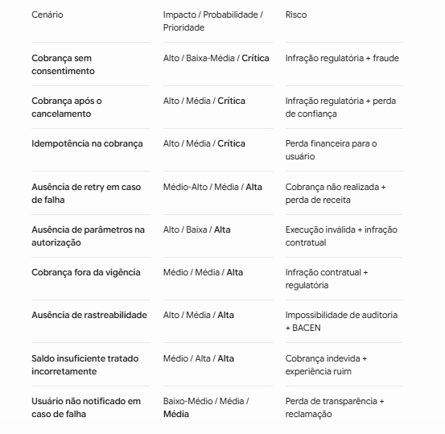

# 2. Matriz de risco

## Versão em texto

| Cenário | Impacto | Probabilidade | Prioridade | Risco |
|---|---|---|---|---|
| Cobrança sem consentimento | Alto | Baixa-Média | **Crítica** | Infração regulatória + fraude |
| Cobrança após o cancelamento | Alto | Média | **Crítica** | Infração regulatória + perda de confiança |
| Idempotência na cobrança | Alto | Média | **Crítica** | Perda financeira para o usuário |
| Ausência de retry em caso de falha | Médio-Alto | Média | **Alta** | Cobrança não realizada + perda de receita |
| Ausência de parâmetros na autorização | Alto | Baixa | **Alta** | Execução inválida + infração contratual |
| Cobrança fora da vigência | Médio | Média | **Alta** | Infração contratual + regulatória |
| Ausência de rastreabilidade | Alto | Média | **Alta** | Impossibilidade de auditoria + BACEN |
| Saldo insuficiente tratado incorretamente | Médio | Alta | **Alta** | Cobrança indevida + experiência ruim |
| Usuário não notificado em caso de falha | Baixo-Médio | Média | **Média** | Perda de transparência + reclamação |
